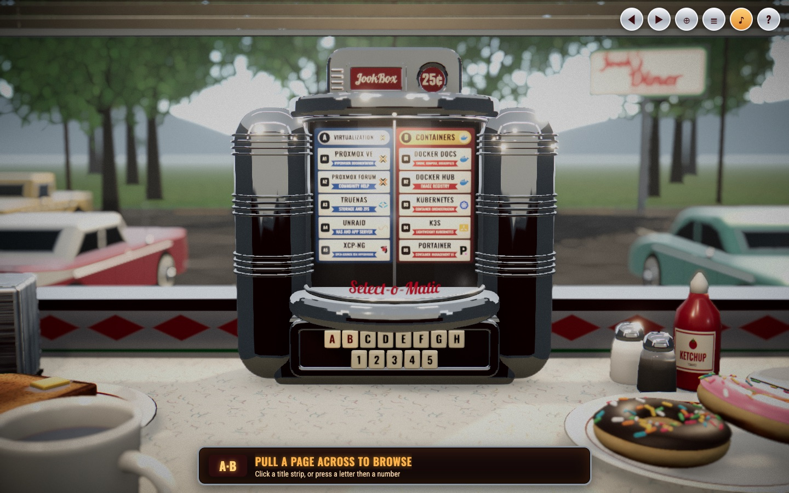
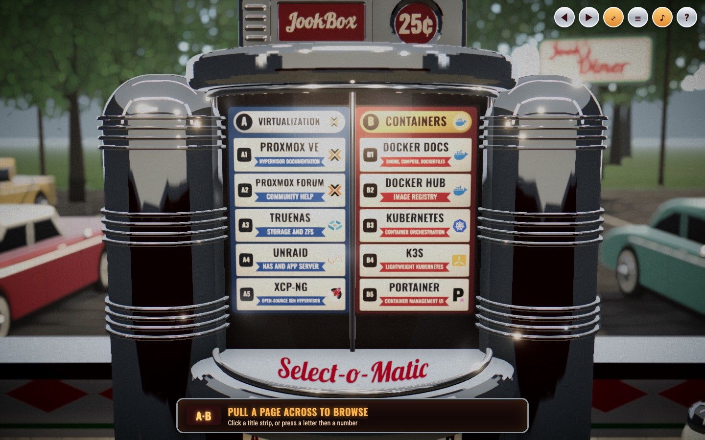

# JookBox

A homelab dashboard you browse like a diner wallbox jukebox, modelled on the
Seeburg Wall-O-Matic 100. Your services are the records: each one is a title
strip on a flip page. You turn the pages by pulling them across with the
mouse, and making a selection opens the service in a new tab.

The jukebox sits at the window end of a booth in a stainless-steel diner:
toast and coffee at one seat, donuts and coffee at the other, napkins and
ketchup pushed up against the box, and a parking lot of fifties cars
outside the window, soft in the background.

It reads the same `services.yaml` and `bookmarks.yaml` files as
[homepage](https://gethomepage.dev), so an existing homepage config drops
straight in. Homepage is the dashboard this grew out of, and the one to use
if you want widgets, status and a layout that fits on a phone; JookBox is
the same links with a quarter in the slot. Thanks to the homepage team for
a config format worth building on.



## Run it

```bash
docker compose up -d --build
```

Open http://localhost:3000. Out of the box it plays a showcase: the
`./config` folder in this repository holds a few pages of well-known
homelab docs and communities, so you can see what it does before giving it
your own links. Edit the YAML and switch back to the tab to see the change;
there's nothing to restart.

**Your own links.** Keep them out of the repository so pulling updates
never clashes with them. Put your `services.yaml`, `bookmarks.yaml` and
`settings.yaml` in a `config.local/` folder (git ignores it), or anywhere
else, and point Compose at it with a `.env` file next to
`docker-compose.yml`:

```bash
JOOKBOX_CONFIG=./config.local
```

Then `docker compose up -d`. If the folder is empty on first run, a starter
config is copied in, the same way homepage does it.

**File permissions.** The container runs as user 1000 unless told
otherwise, so on a host where your account has a different ID it can't
read a private config folder. Rather than opening the files up to
everyone, run the container as yourself and keep them private:

```bash
printf 'JOOKBOX_UID=%s\nJOOKBOX_GID=%s\n' "$(id -u)" "$(id -g)" >> .env
chmod 700 config.local && chmod 600 config.local/*.yaml
docker compose up -d
```

Once the files exist, you can also add `:ro` to the volume in
`docker-compose.yml` so the container can't change them. Already running
homepage? `npm run import:homepage` (below) fills it from your live
dashboard.

`docker-compose.yml` publishes port 3000 on every interface. Set
`JOOKBOX_PORT` to change it, or `JOOKBOX_IMAGE` to run a registry image
instead of building one: CI publishes `ghcr.io/goliathgear/jookbox:latest`
from `main`.

**On a slower machine**, open it with `?fx=off` on the URL
(http://localhost:3000/?fx=off). That turns off the post-processing (ambient
occlusion, depth of field, bloom, grain), which is where most of the GPU time
goes; the scene is the same. It only draws a frame when something moves, so
it costs nothing while it sits there. Without WebGL at all it falls back to
the list view, so the links still work.

**On Coolify** (or any host that builds from git), create an application
from this repository with the Dockerfile build pack and port 3000. For
your own links, add persistent storage mounted at `/app/config` and put
your YAML in it; edits apply on the next page load. Without storage it
serves the starter config. To serve the showcase instead, set
`CONFIG_DIR=/app/bundled-config`: the image carries the repository's
`config/` folder there, as of the commit it was built from.

## Playing it

| To                   | Do this                                                                                   |
| -------------------- | ----------------------------------------------------------------------------------------- |
| Turn pages           | Grab a page and pull it across; it follows the mouse and settles on the nearest page. A quick flick finishes the turn you were making. Also: mouse wheel, ← / →, ◀ ▶, swipe |
| Play a selection     | Click its title strip, or press its page letter then its number: **C** then **2** plays C2 |
| See the whole booth  | The page opens on the booth and pushes in to the jukebox. **⤢** pulls back out and **⊕** pushes in again (+ / −). Hovering a strip shows it in the ticker at the bottom. Moving the mouse tilts the view a few degrees |
| Plain links          | **☰** opens the list view: real links you can middle-click or copy                        |
| Everything else      | **?** shows the controls and any config warnings. Esc clears a half-typed selection        |

Without WebGL you get the list view.



## Configuration

Three files in `config/`, all optional except `services.yaml`.

### services.yaml and bookmarks.yaml

Exactly [homepage's format](https://gethomepage.dev/configs/services/). Each
group starts on a new page, and a group too long for one page continues on
the next. Each service becomes one title strip:

| Strip part           | Comes from                                                            |
| -------------------- | --------------------------------------------------------------------- |
| Title (top line)     | the service name                                                      |
| Artist (red ribbon)  | `artist:`, else `description:`                                        |
| Album (bottom line)  | `album:`, else whatever `jukebox.album` says (nothing, by default)    |
| Icon                 | `icon:`, using homepage's icon names (see below)                      |
| Code badge           | page letter + strip number, e.g. **B3**; assigned automatically       |

```yaml
- Media:
    - Jellyfin:
        href: https://jellyfin.lan
        description: Movies and TV     # the artist ribbon
        album: Living room             # optional third line
        icon: jellyfin.png
        target: _self                  # optional, overrides the default
```

Keys the jukebox doesn't use (`widget`, `siteMonitor`, `server`,
`container`, ...) are ignored and never sent to the browser, so widget API
keys stay on the server. Links with `javascript:`, `data:` or `file:` URLs
are skipped with a warning. Nested groups get their own pages after their
parent. Bookmark groups go after the service groups.

### settings.yaml

homepage's `settings.yaml` works too; the jukebox reads `title`, `target`
and `layout` from it and ignores everything else.

```yaml
title: Select-o-Matic           # the red script on the jukebox's glass (and the tab title)
subtitle: JookBox               # the badge on the coin head, in raised letters
sign: Jook's                # the roadside sign outside reads "<sign> Diner"

jukebox:
  stripsPerPage: 5            # 3-10
  wrap: false                 # true: past the last page, riffle back to page A
  sound: true                 # flips, clicks and the selection bell (viewers can mute)
  target: _blank              # default link target
  openAs: tab                 # tab, or window for a separate browser window
  icons: true                 # icons on the strips
  album: none                 # bottom line when an entry has no album: none, host or group
  bookmarks: true             # include bookmarks.yaml

layout:                       # page order and per-group styling
  Infrastructure:
    theme: blue               # classic | blue | green | black
    color: "#ff9900"          # page colour override
    icon: proxmox.png         # header icon
```

Groups listed under `layout` come first, in that order. The rest follow in
`services.yaml` order.

### Icons

The same names homepage accepts:

- `grafana.png` (or `.svg` / `.webp`) uses [dashboard-icons](https://github.com/homarr-labs/dashboard-icons)
- `mdi-chart-line` uses [Material Design Icons](https://pictogrammers.com/library/mdi/)
- `si-github` uses [Simple Icons](https://simpleicons.org/)
- `sh-name` uses [selfh.st icons](https://selfh.st/icons/)
- `/icons/mine.png` is your own file in `config/icons/`
- any `https://` URL

Icons load from the jsDelivr CDN in the browser. If the browser can't reach
the CDN, the strips are drawn without icons.

### Secrets and environment variables

As in homepage, `{{HOMEPAGE_VAR_NAME}}` in any YAML file is replaced with
that environment variable, and `{{HOMEPAGE_FILE_NAME}}` with the contents of
the file that variable points to. `JOOKBOX_VAR_` and `JOOKBOX_FILE_`
work the same way. Set them under `environment:` in `docker-compose.yml`.

### Importing from a running homepage

```bash
npm run import:homepage -- https://homepage.example.com config.local --force
```

This writes `services.yaml` and `bookmarks.yaml` from homepage's
`/api/services` and `/api/bookmarks` endpoints. It only copies name, href,
description, icon and target. The config in this repo was made this way
from the Rex Rides homepage.

## Development

Node 24 or newer.

```bash
npm install
npm run dev          # Vite on :5173, with the API served from ./config
npm test             # unit tests (config loading, paging, keypad, server)
npm run typecheck
PW_CHANNEL=chrome npm run test:e2e   # browser tests; drop PW_CHANNEL after `npx playwright install chromium`
```

`npm run build && npm start` runs the production server on :3000.

| Path         | What's there                                                                          |
| ------------ | ------------------------------------------------------------------------------------- |
| `server/`    | Fastify: loads and validates the YAML, serves `/api/config`, the bundle and `/icons/` |
| `shared/`    | Types, page themes, and the catalog: groups → pages → selection codes, page geometry  |
| `src/scene/` | The 3D scene (React Three Fiber): wallbox, diner, parking lot, procedural surfaces     |
| `src/hud/`   | DOM overlays: ticker, controls, help, list view                                       |
| `e2e/`       | Playwright tests and their fixture config                                             |

The server runs TypeScript directly through Node's type stripping, so there's
no server build step. The browser renders on demand rather than every frame,
which keeps an idle dashboard tab cheap.

### How the page turning works

The title rack is a book bound at a vertical centre spine. View *v* shows
page side 2*v* on the left and 2*v*+1 on the right. Leaf *j* carries side
2*j*−1 on its front and 2*j* on its back. One continuous `pagePos` value is
sprung toward the current view, and leaf *j* is mid-turn while `pagePos` is
between *j*−1 and *j*. That's why jumping several pages riffles them over one
after another, and why a page you are dragging can follow the mouse. Strip text and
artwork are painted onto canvas textures, and clicks are hit-tested from the
texture coordinates using the same strip geometry (`shared/catalog.ts`).

### The real thing

The model is the chrome Seeburg Wall-O-Matic 100 (3W1-100, 1949-58), the
wallbox mounted at each diner booth and wired to the jukebox. The parts
borrowed from it:

- the two big rounded chrome pods either side of a bow-front window
- title pages that turn round a centre spine inside that window
- the chrome hood with its coin head: a maker's badge in white script
  standing out of a sunken oxblood field (here it reads `subtitle`, or
  JookBox), and beside it the round coin entry: a shallow dish in the same
  red with 25¢ across it
- the fat chrome bumper under the window, with the name in red script on
  the glass above it (here, `title`)
- two rows of square Bakelite keys: letters on top, numbers underneath. The
  letters skipped I so it couldn't be mistaken for 1, and the page letters
  here skip I and O for the same reason

The cabinet is built from primitives in `src/scene/Wallbox.tsx`; the
measurements live in `src/scene/dims.ts`. The diner (`Diner.tsx`), the
breakfast (`Tableware.tsx`), the napkins and condiments (`Props.tsx`), cars
(`Cars.tsx`), trees (`Trees.tsx`) and parking lot (`ParkingLot.tsx`) are
built the same way. Nothing is downloaded: the artwork is painted on
canvases (`dinerArt.ts`), and the surface detail is generated
(`surfaces.ts`): value noise turned into normal maps for the asphalt, bark,
vinyl and dough, roughness maps with fingerprints and scratches for the
chrome, brushing for the steel, smudges for the glass. The parking lot is a
scaled-down diorama behind the window rather than life size.

### The camera look

What makes it read as a photograph rather than a drawing is mostly the
lighting and the lens, not the geometry:

- A late-afternoon sun comes in through the window at about 30°, low
  enough to clear the sill, and casts the jukebox's shadow across the
  table (4096² shadow map). A warm spot over the booth is the key light on
  the jukebox face; a physically based sky (`drei`'s `Sky`) lights the lot.
- The chrome reflects a small studio of soft boxes standing in for the
  diner: fluorescent tubes on the ceiling, the red booth backs low down,
  daylight through the window.
- The post-processing stack (`Look` in `Stage.tsx`): ambient occlusion
  (N8AO), depth of field focused on the jukebox, a little bloom on the
  lamps, chromatic aberration at the edges, film grain, a vignette, a
  slight desaturation, and ACES filmic tone mapping at an exposure of 0.55.

A few URL switches help when tuning it: `?fx=off` (see "Run it") renders
without the post-processing stack, `?view=over` looks down on the booth from the side
to check where the light falls, `?cam=x,y,z,lx,ly,lz` parks the camera at
a point looking at another for a close look at one prop, and `?debug`
exposes the scene, camera and renderer as `window.__three` in the console.

## Roadmap

**Phase 2: cloud provider pages.** Separate pages per CSP, with the page in
the provider's colour and its logo in the header. The plumbing is already
there: a group's `layout` entry takes `color` and a header `icon`, and
`shared/themes.ts` is where `aws` / `azure` / `gcp` theme presets will go,
so a group can just say `theme: aws`.

Other ideas:

- Status lamps on the strips from homepage's `siteMonitor` / `ping`
- A coin dropping into the slot and a record-drop sound when a selection plays
- More cabinet models (a floor-standing jukebox)

## License and credits

JookBox is released under the [MIT License](LICENSE).

- **[homepage](https://gethomepage.dev)** by the
  [gethomepage](https://github.com/gethomepage/homepage) team is where the
  idea, the config format and the icon shorthand come from. JookBox
  reimplements the format and shares no code with homepage, which is its own
  project under the GPL-3.0.
- **Icons** are fetched at view time, never bundled, from
  [dashboard-icons](https://github.com/homarr-labs/dashboard-icons),
  [selfh.st icons](https://selfh.st/icons/),
  [Material Design Icons](https://pictogrammers.com/library/mdi/) and
  [Simple Icons](https://simpleicons.org/). Each is the property of its
  owner, under that set's own licence.
- **Fonts**: [Oswald](https://github.com/googlefonts/OswaldFont),
  [Lobster](https://github.com/impallari/The-Lobster-Font) and
  [Roboto Condensed](https://fonts.google.com/specimen/Roboto+Condensed),
  all under the SIL Open Font License 1.1. The outline subsets used for the
  raised lettering live in `src/scene/fonts/` with their licences.
- The cabinet is modelled on the Seeburg Wall-O-Matic 100 of 1950, a design
  of the Seeburg Corporation. No affiliation is implied.

Everything else, from the diner to the donuts, is drawn in code in this
repository.
